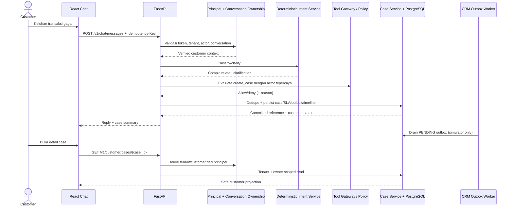

# Unit 06 — Customer-Owned Complaint and Case

**Status:** Draft for review; no application implementation is authorized by this document.  
**Scope anchor:** A customer reports “Transaksi saya gagal, tetapi saldo saya terpotong.” through the authenticated chat, receives a backend-backed case reference/status, and can retrieve only their own case. The transaction is not reversed and its status is not asserted unless a permitted simulator result verifies it.

## 1. Tujuan dan batas cakupan

Unit ini menutup jalur complaint-to-case untuk customer: pesan terautentikasi → penentuan intent yang dapat dibuktikan → pemeriksaan ownership dan policy → deduplikasi → persist case/outbox/audit → respons chat berisi referensi/status → customer dapat membaca case miliknya.

Termasuk: complaint dari chat; klarifikasi bila intent atau detail belum cukup; case lokal yang durable; proyeksi status customer; list/detail customer-scoped; pencatatan timeline/audit; deduplikasi; perilaku CRM simulator tidak tersedia; UI minimum untuk menampilkan dan membuka case.

Tidak termasuk: transfer/reversal atau perubahan rekening; klaim bahwa saldo dikembalikan; akses langsung LLM ke database; mengaktifkan Gemini live; upload/retensi file bukti; keputusan final severity HIGH/CRITICAL oleh AI; resolusi/penutupan case oleh customer; redesign UI; integrasi CRM eksternal sungguhan kecuali adapter simulator memang sudah ditetapkan dan tersedia. Unit 07 tetap pemilik formulir complaint umum dan pengalaman tracking yang lebih lengkap sesuai build plan.

## 2. Referensi FRD/TRD yang relevan

| Referensi | Ketentuan yang relevan |
|---|---|
| FRD v0.9, p.63, FR-CASE-001 / BR-CASE-09 | Complaint dapat memicu `create_case` lewat tool layer; service memberi ID, status LOGGED dan queue; open case yang cocok ditautkan agar tidak duplikat; CRM down memakai outbox dan harus menghasilkan task/follow-up manusia; AI tidak menetapkan HIGH/CRITICAL final tanpa konfirmasi manusia. |
| FRD v0.9, pp.64–65, FR-CASE-002…005 | Klasifikasi dan riwayat reclassify; owner/queue; timeline append-only; hubungan conversation-case dapat many-to-many; case duplikat/terkait memiliki relasi dan referensi yang bertahan. |
| FRD v0.9, p.65, FR-CASE-006 | Recovery finansial adalah rekomendasi/penanganan case, bukan eksekusi transaksi oleh AI. |
| FRD v0.9, p.67, FR-CASE-010 | Customer hanya melihat status yang telah dipetakan: Received, Under review, Waiting for customer, Outcome ready, Closed, Reopened; detail internal, nama petugas, dan queue tidak dibuka. |
| TRD v0.9, §6.3.6, p.33 | Model case memuat tenant/customer/conversation, reference, kategori, severity proposed/confirmed, risk, description, status customer-visible, ownership, timestamps, SLA dan relasi. Timeline case bersifat append-only. |
| TRD v0.9, §6.3.9, p.34; §8.6–8.9, sekitar pp.45–46 | Outbox state/attempt/error; idempotency dan retry; degradasi tool/CRM; CRM tidak tersedia memerlukan outbox dan status yang jujur. |
| Build plan, `context/specs/00-build-plan.md`, Unit 06 | Complaint/ticket ownership, validation, customer status, audit. Unit 07 memakai API Unit 06 untuk form/tracking UI. |
| Unit 04/05 active specs | Chat idempotency/ownership boundary dan current deterministic orchestrator; Unit 05 leaves complaint-to-case to Unit 06. |

**Versi dokumen:** audit menyebut FRD/TRD v0.9; TRD merujuk FRD v1.0 approved/frozen, tetapi salinan v1.0 yang disahkan tidak ditemukan dan persetujuan TRD §16 belum terbukti. Ada perbedaan degradasi CRM: FRD p.63 menyebut reference akan menyusul setelah recovery, sementara TRD §8.9 menyebut local reference. Ini perlu keputusan product/mentor sebelum copy/status degraded dianggap final. Spec ini tidak menyamarkan konflik tersebut.

## 3. Kondisi kode aktual dan komponen yang dapat digunakan kembali

### Temuan aktual

- `POST /v1/chat/messages` sudah memakai verified principal, customer `WEB_CHAT`, ownership conversation, validasi text, `Idempotency-Key`, ledger PostgreSQL, persist pesan, lalu memanggil `orchestrator.run_turn`. Replay key dan payload sama mengembalikan hasil tersimpan; payload berbeda ditolak. Lihat `app/modules/routes_a.py` dan Unit 04.
- Orchestrator memakai classifier deterministik (`app/modules/intent.py`), bukan Gemini. `CMP_TRANSACTION_DISPUTE` ada, tetapi daftar frasanya belum mencakup persis kalimat skenario. Complaint path/create case belum ada di `run_turn`; target kalimat perlu test klasifikasi dan kemungkinan klarifikasi konservatif.
- `CaseRow`, `SlaRecordRow`, dan `CrmOutboxRow` PostgreSQL tersedia. `Store.create_case_db()` membuat case, SLA dan outbox dalam satu transaksi. Model CaseRow belum menyimpan seluruh field kontrak TRD (antara lain description, risk, source channel, created_by, owner_id, timeline/link history). `origin_conversation_id` dan `logged_at` sudah tersedia.
- `cases.CreateCaseIn` memiliki lebih banyak field, tetapi modul legacy `cases.py` juga menyimpan data in-memory. Jangan gunakan dictionary legacy sebagai sumber kebenaran untuk flow customer.
- `POST /v1/cases` memerlukan `case.create`; role customer saat ini tidak memiliki permission tersebut. `GET /v1/cases/{cid}` memerlukan `case.read` dan query yang diperiksa membatasi tenant/customer, dengan test lintas customer/tenant yang ada. Belum ada customer list/detail API terpisah yang aman untuk portal.
- Tool registry mendefinisikan `create_case` sebagai tool AL1/idempotent, tetapi role/policy dan assurance session customer dapat menolak jalur itu. Orchestrator memiliki executor hardcoded untuk beberapa tool; endpoint tool invocation juga tidak membuktikan bahwa CRM case adapter nyata dipanggil. Penambahan flow harus tetap lewat gateway/policy yang berlaku, bukan memanggil executor atau DB dari LLM.
- `Store.create_case_db()` menulis event ke `audit_svc` sesudah commit DB. `audit_svc` saat ini in-memory, sehingga event bukan audit durable/atomic lintas restart. Belum ditemukan tabel case timeline append-only yang memenuhi FR-CASE-004.
- Outbox worker dan `CRM_AVAILABLE` simulator tersedia. Saat CRM unavailable, case lokal dan outbox PENDING disimpan; drain mencatat error/attempt. Saat available, worker menandai SENT tanpa call ke CRM eksternal. Belum ditemukan retry backoff/max attempts, terminal FAILED/reconciliation task, atau handoff otomatis akibat kegagalan CRM. Karena itu `SENT` saat ini tidak boleh disajikan sebagai bukti sinkronisasi CRM nyata.
- `HandoffRow`/handoff flow tersedia untuk percakapan, tetapi package context masih `package_complete=false`; belum terbukti menjadi task rekonsiliasi CRM.
- Transaction simulator `corebank` berisi data sintetis, tetapi lookup memerlukan identifier/status path tertentu dan policy assurance. Kalimat skenario tidak memuat transaction ID. Tanpa bukti lookup simulator yang berhasil, status transaksi tetap “belum dapat diverifikasi”.
- Customer auth/dev identity dan challenge/consent memiliki batas simulator/in-memory. Trust untuk ownership pada Unit ini harus bersumber dari signed `VerifiedPrincipal` dan owner conversation server-side; jangan menerima `customer_id`/`tenant_id` dari body.
- Redis dipakai untuk refresh token rotation, bukan sebagai sumber case/idempotency/outbox. Redis tidak aktif memengaruhi refresh flow fail-closed, tetapi tidak perlu menghalangi case jika PostgreSQL tersedia dan idempotency/dedupe durable di DB.
- UI React/Vite memiliki chat customer dan route placeholder `/customer/requests` serta `/customer/requests/new`. Chat mengirim request dan idempotency key lalu memuat history; belum memproyeksikan case object atau memiliki customer case tracking yang terhubung.
- Migrasi diperlukan jika kontrak Unit 06 mengharuskan field/tabel durable yang belum ada. Alembic scaffold/migration setup perlu diperiksa sebelum implementasi; spec tidak menjalankan migration.

### Komponen reuse

`VerifiedPrincipal`/RBAC dan conversation ownership; chat message + request ledger; `IntentSvc`; `ToolGateway`/policy evaluation; SQLAlchemy `CaseRow`, SLA/outbox dan store transaction; case status vocabulary/projection; handoff service jika sesuai kontrak; customer `req()` API helper dan chat UI; test fixtures tenant/customer. Semua reuse tunduk pada keputusan permission dan assurance di §16.

## 4. User journey dan sequence flow

1. Customer login dan mengirim teks skenario di conversation yang dimiliki tokennya. Browser mengirim `Idempotency-Key`; identitas/tenant berasal dari principal, bukan body.
2. API memvalidasi ukuran/format, tenant, actor, conversation ownership dan key. Inbound message tercatat sesuai flow chat yang ada.
3. Intent service menentukan intent. Untuk frasa skenario, test harus membuktikan intent `CMP_TRANSACTION_DISPUTE` atau sistem meminta klarifikasi yang spesifik. Tidak ada tool/case side effect dari hasil ambigu.
4. Complaint flow mengecek apakah detail cukup. Tidak adanya transaction reference berarti tidak ada lookup yang dapat memverifikasi transaksi; sistem boleh membuat complaint berisi klaim customer sebagai laporan, bukan fakta transaksi.
5. Backend mengevaluasi policy/tool dengan principal/actor tepercaya dan permission yang disepakati. LLM (bila kelak ada) hanya mengusulkan intent/kategori/severity; service memvalidasi semuanya.
6. Case service melakukan duplicate lookup, validasi nilai, membuat case (atau menautkan conversation ke case terbuka yang cocok), SLA, outbox dan timeline dalam transaksi DB. Reference/status diambil dari row commit.
7. Jika CRM simulator tidak tersedia, case lokal/outbox tetap tercatat sesuai perilaku yang diuji. Backend menyampaikan hanya keadaan lokal yang tersimpan dan status tindak lanjut yang benar-benar tercatat; tidak menyatakan CRM sync atau human task berhasil jika belum ada buktinya.
8. Chat mengembalikan ringkasan case dan kalimat tidak menjanjikan reversal. UI menampilkan reference/status serta tautan detail.
9. Customer membuka daftar/detail case. API mencari memakai tenant dan customer dari principal; ID yang tidak dimiliki merespons 404 agar tidak membocorkan keberadaan record.

### Sequence (rancangan)



## 5. API yang diperlukan

Tidak menambah endpoint create publik untuk customer secara default. Jalur complaint adalah chat; endpoint internal `POST /v1/cases` tetap untuk aktor yang telah memiliki `case.create` sampai policy menyetujui bentuk service authorization untuk chat.

### Chat complaint

**Reuse:** `POST /v1/chat/messages` dengan schema dan `Idempotency-Key` yang ada. Contoh request:

```http
POST /v1/chat/messages
Authorization: Bearer <customer-session>
Idempotency-Key: turn-7b48d69a-9f5b-4f4f-ae3a-1b42c8cae201
Content-Type: application/json
```

```json
{
  "text": "Transaksi saya gagal, tetapi saldo saya terpotong.",
  "conversation_id": "CNV-example"
}
```

Contoh hasil setelah case lokal berhasil commit (nilai ilustrasi, bukan reference nyata):

```json
{
  "conversation_id": "CNV-example",
  "reply": "Laporan Anda telah tercatat dengan referensi CASE-EXAMPLE. Status saat ini: Diterima. Kami belum dapat memverifikasi status transaksi atau menyatakan saldo telah dikembalikan.",
  "intent": {"intent_code": "CMP_TRANSACTION_DISPUTE", "decision": "ACT"},
  "case": {
    "case_id": "CASE-example-internal-id",
    "customer_reference": "CASE-EXAMPLE",
    "customer_visible_status": "RECEIVED",
    "created_at": "2026-01-01T00:00:00Z",
    "reused_existing": false
  }
}
```

ID/reference/timestamp contoh bukan data sistem. Response real harus dibentuk dari hasil DB commit; jangan menyisipkan status transaksi hasil LLM. Jika classifier ragu, response memuat pertanyaan klarifikasi dan tidak ada `case`/side effect.

### Customer case list/detail (endpoint baru)

`GET /v1/customer/cases?limit=20&cursor=...` mengembalikan daftar terbatas dan terurut, scoped tenant/customer dari principal. `GET /v1/customer/cases/{case_id}` mengembalikan satu projection. Query/filter tidak menerima customer_id atau tenant_id dari client. Response detail hanya field yang disetujui sebagai customer-visible.

```json
{
  "items": [{
    "case_id": "CASE-example-internal-id",
    "customer_reference": "CASE-EXAMPLE",
    "category": "TRANSACTION_DISPUTE",
    "customer_visible_status": "RECEIVED",
    "created_at": "2026-01-01T00:00:00Z",
    "updated_at": "2026-01-01T00:00:00Z"
  }],
  "next_cursor": null
}
```

Detail boleh menambah deskripsi laporan customer, event timeline customer-visible dan evidence yang diminta customer, jika memang sudah persisted dan disaring. Jangan mengembalikan internal status, `owner_id`, queue, nama petugas, internal note, risk signal, severity proposed/internal, audit metadata, CRM error, atau data pihak lain. Pertimbangkan `customer_reference` sebagai identifier tampilan; path `case_id` tetap wajib ownership check.

Error contract mengikuti pola API yang ada: 401 tanpa principal valid; 403/step-up hanya sesuai policy yang telah ditetapkan; 404 untuk case bukan milik customer/tenant; 409 untuk idempotency key dengan fingerprint berbeda atau request yang masih in-progress sesuai kontrak chat; 422 untuk payload tidak valid; 503 hanya bila case lokal tidak dapat dipersist dan tidak ada hasil sukses. Jangan jawab sukses jika commit gagal.

## 6. Data model dan relasi

Gunakan `CaseRow` dan tabel saat ini jika kompatibel; migration baru diperlukan untuk gap berikut (daftar final setelah schema/migration scaffold diverifikasi):

| Entitas | Isi minimum / relasi |
|---|---|
| `case` | `case_id`, `tenant_id`, `customer_id`, `origin_conversation_id`, customer reference unik, category/subcategory, `description`, `source_channel`, `severity_proposed`, `severity_confirmed`, `risk_level`, internal/customer status, owner_id/owner_queue, created_by/type, logged/created/updated timestamps, SLA version/reopen count. Tenant + customer + conversation references harus tervalidasi. `logged_at` dapat memetakan created time bila disepakati. |
| `case_conversation_link` | Relasi conversation↔case sesuai FRD many-to-many; link type/source/timestamp. `origin_conversation_id` tetap sebagai origin/backward compatibility. |
| `case_timeline_entry` | Append-only event case: event type, actor/type, timestamp, correlation, customer-visible flag, safe payload. Case/outbox/timeline initial event commit atomically. |
| `case_creation_request` (atau setara) | Unique scoped key/fingerprint yang mengaitkan idempotent create request ke case, tanpa menyimpan raw `Idempotency-Key`; untuk retry lintas crash. Alternatif reuse chat request ledger hanya bila relasi dan commit atomic dapat dijamin. |
| `sla_record` | Pakai tabel yang ada; dibuat bersama case. |
| `crm_outbox` | Pakai tabel yang ada; row PENDING dibuat dalam transaksi yang sama. Perlu kontrak eksplisit untuk retry/error/terminal state dan bukti keberhasilan simulator. |

`customer_id` harus non-null untuk jalur customer-owned. Customer reference tidak boleh mudah ditebak dan unik dalam scope yang dipersyaratkan TRD (dikonfirmasi terhadap schema existing). FK/constraint dan index tenant/customer/status dibutuhkan untuk ownership dan list. Jangan menyimpan severity HIGH/CRITICAL sebagai confirmed sebelum actor/approval manusia yang berwenang mencatat konfirmasi.

## 7. Ownership dan authorization

- Identitas, tenant, role dan assurance hanya dari token principal terverifikasi; conversation harus mempunyai `tenant_id` dan customer owner yang sama.
- Customer list/detail query wajib `tenant_id = principal.tenant_id AND customer_id = principal.actor_id`; kegagalan match menghasilkan 404. Jangan hanya melakukan fetch by case ID lalu menyaring di UI.
- Customer tidak boleh mengirim/mengubah `customer_id`, `tenant_id`, actor, owner, status, severity confirmed, internal notes, outbox state, audit fields, maupun `created_by`.
- Penulisan case harus melewati `ToolGateway`/policy atau service authorization yang disetujui. Fakta saat ini: customer tidak memiliki `case.create`; jangan menambahkan permission tersebut otomatis dan jangan menaikkan assurance secara diam-diam. Keputusan product/security diperlukan apakah chat orchestrator bertindak sebagai service/AI actor dengan permission terdelegasi setelah ownership check, assurance minimum, dan policy allow, atau customer harus step-up/konfirmasi. Principal customer tetap menjadi subjek ownership dan provenance.
- LLM tidak diberi DB session/credential. Hasil model adalah usulan tervalidasi; service yang menjalankan query/mutasi setelah policy.
- Transaction simulator hanya dipanggil bila identifier/consent/assurance dan permission sesuai; input skenario saat ini belum cukup untuk membuktikan transaksi.

## 8. Case lifecycle dan status

Case dibuat sebagai internal `LOGGED`; proyeksi awal FRD `RECEIVED` (“Diterima”). Status customer berikut dipetakan dari event/status backend, bukan teks model:

| Status customer | Makna yang ditampilkan |
|---|---|
| `RECEIVED` | Case lokal tersimpan/diterima. |
| `UNDER_REVIEW` | Pemeriksaan berlangsung. |
| `WAITING_FOR_CUSTOMER` | Ada informasi/evidence yang diminta customer. |
| `OUTCOME_READY` | Ada hasil yang direkam dan boleh disampaikan. |
| `CLOSED` | Case ditutup melalui aturan yang sah. |
| `REOPENED` | Case dibuka kembali dengan alasan/event. |

Nama enum existing berbeda sebagian (`BEING_INVESTIGATED`, `WAITING_FOR_YOU`, dll. perlu inspeksi mapping kode); implementasi harus mempertahankan kompatibilitas internal dan memberi mapping eksplisit, versioned dan diuji. Transisi status mengikuti state machine existing/FRD, menolak transisi ilegal, menulis timeline dan mengubah projection dalam transaksi. Unit 06 tidak memberi customer endpoint untuk close/reopen.

Untuk skenario ini tidak ada pemeriksaan transaksi tanpa reference/simulator result; deskripsi dan respons menyatakan “customer melaporkan transaksi gagal dan saldo terpotong” sebagai laporan. Case tidak menjadi bukti debit dan tidak memicu reversal.

## 9. Idempotency dan duplicate-case handling

1. Pertahankan chat idempotency key/fingerprint saat ini; response completed yang sama dikembalikan tanpa membuat pesan/case kedua.
2. Buat idempotency case durable dan unique scoped tenant/customer/request, satu transaksi dengan case/outbox/timeline/SLA. Simpan hash/key turunan, bukan raw key. Recovery setelah crash harus mengembalikan case awal.
3. Matching existing open case harus deterministik: tenant + customer + category + identifier insiden transaksi yang telah diverifikasi (bila tersedia) dan status terbuka. Case cocok ditautkan ke conversation baru dan referensi case lama dikembalikan; jangan membuat duplikat.
4. Bila tak ada transaction reference, jangan menganggap semua complaint kategori sama sebagai satu insiden. Minimal dedupe berdasarkan request idempotency; kemiripan lintas conversation harus meminta klarifikasi atau tidak auto-merge sampai aturan pencocokan FRD disepakati. Kalimat skenario tanpa transaction reference belum cukup untuk dedupe lintas conversation.
5. Unique constraint/index harus menjadi penjaga konkurensi; pola “select lalu insert” tanpa constraint bukan idempotency.

**Keputusan terbuka:** TRD §8.6 menggambarkan idempotency key untuk tool (conversation + intent + tool + version + canonical args + attempt group), sedangkan endpoint chat mempunyai key client. Definisikan satu kontrak yang mengaitkan chat request dengan operasi `create_case`, termasuk replay, concurrency, expiry/retention dan status PROCESSING.

## 10. Audit event dan error handling

Event minimal: `case.created`, `case.reused_or_linked`, `case.classification.proposed`, `case.severity.confirmed` (hanya manusia berwenang), `case.status.changed`, `case.crm_sync.pending/succeeded/failed`, `case.handoff.queued` bila memang tercatat. Event menyimpan tenant/case/customer, actor type/id, correlation/request reference, timestamp, before/after status bila relevan, source/provenance. Jangan menyimpan bearer, raw idempotency key, secret atau data pembayaran berlebihan.

Case timeline append-only harus tahan lama dan commit atomic dengan perubahan case yang direpresentasikannya; pembatasan update/delete ditegakkan di service/schema. Existing `audit_svc.emit()` dapat dipakai untuk konsistensi event saat ini, tetapi karena in-memory dan dipanggil sesudah commit, ia belum memenuhi audit durable/atomic TRD. Spesifikasi implementasi harus menyepakati apakah Unit 06 menambah audit row durable khusus case sekarang atau bergantung pada unit audit berikutnya; customer response tidak boleh mengklaim audit durable sampai tersedia.

Failure rules:

- Invalid auth/owner/policy: stop sebelum side effect; response generik yang tidak membocorkan keberadaan case.
- Ambiguous intent/insufficient data: simpan pesan sesuai chat normal, minta klarifikasi terarah, tidak membuat case sampai kondisi FRD terpenuhi.
- DB transaction gagal: rollback case/SLA/outbox/timeline bersama; tidak ada reference sukses di UI.
- Outbox/CRM simulator gagal setelah case lokal commit: case tetap dapat dibaca, state sync tetap pending/failed yang terukur, retry sesuai policy, audit/timeline memperlihatkan kegagalan. Jangan mengulang create case saat retry sync.
- Handoff: hanya katakan antrean/handoff dibuat jika row/ack yang merepresentasikannya telah commit. Jika tidak tersedia, ungkapkan bahwa sinkronisasi/tindak lanjut belum dapat dipastikan.
- Model/LLM down: tidak relevan pada skeleton deterministic; jika provider kelak digunakan, fallback template/clarification tidak boleh mencegah persist complaint yang telah lolos aturan FRD.
- HIGH/CRITICAL: severity proposed dapat dicatat; confirmed tetap NULL sampai konfirmasi manusia sah; tidak mengekspos severity internal pada customer.

## 11. Perilaku saat CRM simulator tidak tersedia

Fakta saat ini: create DB menyimpan case/outbox lokal dan mengembalikan `crm_pending`; worker simulator saat unavailable mempertahankan PENDING dan error; saat available, menandai SENT tanpa koneksi CRM eksternal. Tidak ada retry policy matang atau human reconciliation task otomatis yang terbukti.

Target perilaku Unit 06: commit case lokal + reference + outbox PENDING + timeline secara atomik; worker melakukan retry idempotent dengan backoff/batas yang disetujui, catat attempt/error tanpa data rahasia, lalu menandai sukses hanya setelah simulator mengonfirmasi penerimaan. Sesudah batas retry, state terminal dan task/handoff manusia harus tersimpan sesuai FRD/TRD. Case tetap milik customer dan dapat ditrack tanpa memalsukan status CRM. Response menyebut local case tersimpan dan CRM sync pending, hanya bila pilihan produk menyetujui local reference. Jika keputusan mengikuti FRD “reference menyusul”, API perlu status penerimaan provisional dan tidak boleh mengarang reference final.

Konflik FRD/TRD reference saat CRM down dan definisi “human task” wajib diselesaikan sebelum implementation acceptance. Handoff conversation yang ada bukan otomatis task rekonsiliasi CRM.

## 12. Perubahan frontend yang diperlukan

- `CustomerChat` menggunakan response backend yang sama dan menampilkan case card hanya bila response membawa case yang sudah persisted/reused. Card berisi customer reference, status lokal terbaru, timestamp, dan tautan detail.
- Tampilkan state klarifikasi/error/retry. Gunakan idempotency key yang sama pada retry request yang sama; jangan tampilkan pesan sebagai terkirim sebelum API berhasil.
- Tambahkan customer case list dan detail sederhana pada route `/customer/requests` yang sekarang placeholder atau route case yang konsisten. Detail harus memanggil API; data mock/hardcoded tidak boleh tampak seperti record nyata.
- Label status Indonesia berasal dari projection backend. Jangan tampilkan internal queue, nama agent, status transaksi bank, severity internal, atau janji reversal.
- Loading/empty/error/unauthorized/not-found states. Case dari ID yang dimanipulasi harus menampilkan not-found generik.
- Form complaint umum dan attachment upload penuh tetap Unit 07 kecuali keputusan scope mengubah build plan.

## 13. File yang kemungkinan perlu dibuat/diubah

Daftar ini perkiraan dari audit, bukan perubahan yang telah dilakukan:

| File/area | Perubahan yang mungkin |
|---|---|
| `app/modules/intent.py`, `orchestrator.py` | Test/rule intent skenario dan flow complaint/klarifikasi; pemanggilan service/gateway dan hasil aman. |
| `app/modules/cases.py` atau service baru `case_service.py` | Validasi domain, dedupe, customer projection, lifecycle, transaction boundary. Hindari legacy in-memory `CASES`. |
| `app/modules/store.py`, `models.py` | Persist field/relasi/timeline/idempotency/outbox; ownership-scoped read; atomic writes. |
| `app/modules/routes_a.py` atau router customer baru | Customer list/detail API; chat response case projection. Pertahankan endpoint staff dan schema lama. |
| `app/modules/tool_gateway.py`, `app/core/rbac.py` | Hanya setelah keputusan authorization/assurance; policy case create dan audit decision. Tidak otomatis memberi customer `case.create`. |
| `app/modules/outbox.py`, `worker_outbox.py` | Retry/reconciliation state dan bukti simulator ack; dedupe side effect. |
| `app/core/audit.py` / model audit baru | Durable append-only event bila unit ini bertanggung jawab memenuhinya. |
| Alembic migration(s) | Tambahan schema/index/constraint setelah setup migration diverifikasi; tidak menjalankan migration sebagai bagian spesifikasi. |
| `web-workspace/src/App.jsx` dan kemungkinan komponen customer case baru | Case card di chat, customer list/detail, state UI. |
| `tests/test_*.py` | Domain, API, authorization, outbox, UI/E2E test. |

## 14. Acceptance criteria yang dapat diuji

1. POST chat dengan principal customer valid dan kalimat skenario yang tepat menghasilkan complaint intent **atau** targeted clarification yang tercatat; intent ambiguity tidak membuat case. Test assertion mencakup `intent_code`/decision serta jumlah row.
2. Case sukses hanya diumumkan setelah commit; DB memuat `case_id`, tenant/customer/conversation, kategori, deskripsi provenance customer report, severity proposed/confirmed, status, owner/queue, timestamp dan SLA sesuai kontrak yang disepakati.
3. `customer_reference` dalam response sama dengan row yang committed dan dapat dicari kembali. Tidak ada claim saldo kembali atau transaksi verified tanpa simulator evidence.
4. Replay chat key + payload sama mengembalikan referensi/response sama dan menghasilkan tepat satu case, satu outbox create operation, serta tidak menggandakan timeline creation event. Key sama + payload berbeda ditolak.
5. Dua request bersamaan untuk idempotency/incident key sama menghasilkan satu case atau case reuse/link; unique constraint menghalangi duplikat.
6. Customer A dapat list/detail case miliknya pada tenant yang sama; customer B dan principal tenant lain tidak dapat membaca dengan mengganti path ID, query, cursor, atau body. Uji 404 dan tidak ada side effect/data leak.
7. Request customer tidak bisa memilih tenant/customer, owner, confirmed severity, status, atau internal fields; negative schema/security tests menolak atau mengabaikan field sesuai API convention tanpa mempercayainya.
8. Policy deny/assurance kurang tidak menciptakan case/outbox dan menghasilkan response sesuai step-up/deny contract. Tool hanya berjalan setelah gateway allow.
9. AI-proposed HIGH/CRITICAL tersimpan hanya sebagai proposed; `severity_confirmed` NULL sampai aksi konfirmasi oleh role manusia berwenang; test actor tak berwenang ditolak.
10. Outbox unavailable meninggalkan case lokal dan PENDING (atau provisional state yang disetujui), tidak membuat case kedua saat retry; UI/chat mengungkapkan state yang sesuai. Worker hanya menandai sukses setelah simulator ack. Retry exhaustion menghasilkan satu durable reconciliation/handoff task jika FRD mewajibkan.
11. Setiap create/link/status/outbox transition menghasilkan timeline/audit event dengan correlation dan actor; event tidak dapat diubah/dihapus melalui API customer. Atomicity test memastikan rollback jika salah satu write gagal.
12. Customer response/detail hanya berisi allowlisted projection; tidak ada owner queue, nama staff, internal note/risk, token/secret, CRM raw error, atau transaksi/reversal yang tidak diverifikasi.
13. UI menampilkan loading, empty, success, clarification, API error, unauthorized/not-found dan case card; referensi/status berasal dari API response. E2E memverifikasi case yang sama ada di detail/list.
14. OpenAPI menampilkan schema/header auth/error contract API baru dan customer permission; contract test memastikan tidak menerima ownership fields dari request.

## 15. Rencana pengujian

- **Unit:** frasa complaint target/variasi dan intent ambiguity; status mapping; field validation; matching/dedupe; severity rule; safe response text; policy result handling.
- **Integration:** PostgreSQL transaction create+SLA+outbox+timeline/idempotency; rollback; uniqueness/concurrency; simulated CRM up/down/retry; lifecycle and status projection; request ledger replay/recovery.
- **Security:** forged tenant/customer fields; cross-customer/cross-tenant case IDOR; customer direct create denial; insufficient assurance/policy deny; staff/internal field disclosure; unexpected body fields; pagination/cursor scoping.
- **API/contract:** chat request/response and replay; list/detail 200/404; validation/401/409/422/503; OpenAPI route/security/schema.
- **Frontend/E2E:** authenticated customer sends scenario; clarification or persisted case response; card reference/status matches database/API; opens detail; second customer cannot see it; CRM unavailable display remains honest; keyboard/error/loading states.
- Jangan jalankan test yang memerlukan network/provider/real transaction. Test build/runtime hanya ketika implementation dikerjakan dan diminta sesuai project policy.

## 16. Risiko, asumsi, dependensi dan pertanyaan terbuka

### Risiko

- Customer role tidak punya `case.create` dan tool create AL1, sementara dev customer session bisa AL0. Menghindari ini lewat permission bypass membuat authorization cacat.
- Intent target belum terjamin oleh rule sekarang; generic `gagal` dapat memilih intent lain/ambigu.
- Case model dan audit/timeline belum memenuhi seluruh kontrak FRD/TRD; migration dan atomicity dibutuhkan.
- Idempotency chat tidak otomatis melindungi case jika crash sesudah case commit atau customer mengulang dari key berbeda.
- CRM “SENT” saat ini hanya simulator state; jangan klaim integrasi eksternal, retry efektif, atau task manusia.
- Duplicate matcher tanpa transaction ID dapat menggabungkan dua insiden berbeda atau membiarkan duplikat.
- FRD/TRD approval/version conflict membuat detail SLA, status dan outage response belum final.
- Unit 05 masih in progress (browser/accessibility verification). Pekerjaan Unit 06 dapat dispesifikasikan, tetapi integrasi implementasi bergantung pada stabilnya contract chat dan verification Unit 05.

### Asumsi desain yang perlu disetujui

- PostgreSQL adalah sumber kebenaran lokal case; reference dapat ditampilkan hanya sesudah local commit.
- Chat adalah satu-satunya jalur create customer pada unit ini; tidak membuka `case.create` langsung untuk customer.
- Untuk target phrase tanpa transaction reference, complaint dapat dicatat sebagai laporan customer, dengan fakta transaksi tetap unverified.
- Redis tidak dibutuhkan untuk correctness case; DB unique constraint dan outbox menjadi durable authority.
- Gemini live tidak dibutuhkan; classifier deterministic + targeted clarification cukup untuk skeleton.

### Pertanyaan terbuka sebelum coding

1. Apakah service/orchestrator berwenang membuat case atas nama authenticated customer setelah ownership check, atau perlu customer step-up/confirmation? Permission/assurance mana yang menjadi sumber keputusan dan bagaimana didelegasikan tanpa memperluas RBAC customer?
2. Saat CRM down, apakah reference lokal boleh langsung ditampilkan (TRD) atau reference harus menyusul (FRD)? Apa definisi simulator ACK yang valid?
3. Apa yang dimaksud task/handoff manusia untuk CRM failure, siapa queue owner, SLA dan event/status-nya? Bolehkah `HandoffRow` dipakai atau diperlukan reconciliation task khusus?
4. Kriteria matching “open case yang cocok” tanpa transaction reference: apakah wajib meminta transaction reference/tanggal/nominal sebelum create, atau boleh create sebagai complaint awal dan hanya dedupe berdasarkan request/conversation?
5. Status enum customer yang final dalam bahasa API: harmonisasi mapping kode existing dengan FRD `UNDER_REVIEW`/`WAITING_FOR_CUSTOMER`.
6. Apakah deskripsi case menyimpan teks asli customer atau template terstruktur + referensi message? Aturan masking/retensi apa yang berlaku?
7. Apakah audit global durable harus masuk Unit 06 atau ada unit/keputusan terpisah? Retensi dan actor fields apa yang disyaratkan?
8. FRD/TRD mana yang menjadi baseline resmi (FRD v0.9 vs referensi v1.0; status persetujuan TRD)?
9. Konfirmasi bahwa perluasan minimum UI tracking boleh berada di Unit 06 meski build plan menempatkan full UI form/tracking pada Unit 07.

### Dependensi

- Unit 01–02: principal, tenancy, RBAC/policy, customer identity yang tepercaya.
- Unit 04–05: chat conversation ownership/idempotency dan response contract stabil; Unit 05 verification browser/a11y masih terbuka.
- Migration/schema baseline PostgreSQL dan test database tersedia.
- Keputusan policy/assurance, outage/reference, dedupe, status mapping, audit durability.
- Unit 07 untuk form complaint/attachment dan portal tracking lebih lengkap; Unit 08 untuk handoff workspace/context yang lengkap. Gemini/provider live bukan dependensi Unit 06.

## 17. Urutan implementasi bertahap

1. **Resolve contract:** setujui authorization/assurance case create, status vocabulary, duplicate matching, CRM-down reference/task, audit durability dan baseline FRD/TRD. Verifikasi setup migration.
2. **Schema/domain:** migration additive untuk field/relasi/timeline/idempotency; constraints/index; service create/link/read dengan atomic transaction dan customer projection.
3. **Policy + intent:** tambah tests untuk target phrase dan clarification; integrasikan complaint flow melalui tool gateway/service policy; pertahankan deny/step-up dan provenance. Belum hubungkan Gemini.
4. **Outbox/audit:** implementasikan retry/idempotent simulator ACK dan exhaustion/human task berdasarkan keputusan; catat timeline/audit atomic.
5. **API:** perluas chat result dari committed service result; tambah customer list/detail scoped endpoints dan OpenAPI/error contract.
6. **Frontend:** chat case card + list/detail minimal, loading/error/empty/clarification and safe labels.
7. **Verification:** jalankan unit/integration/security/API/E2E yang dirinci di §15; buktikan no duplicate, ownership, failure truthfulness, severity guard; baru perbarui progress tracker/audit setelah hasil nyata.

---

**Dokumen ini adalah spesifikasi untuk review. Belum ada kode aplikasi, migration, konfigurasi, dependency, `.env`, atau data yang diubah.**
